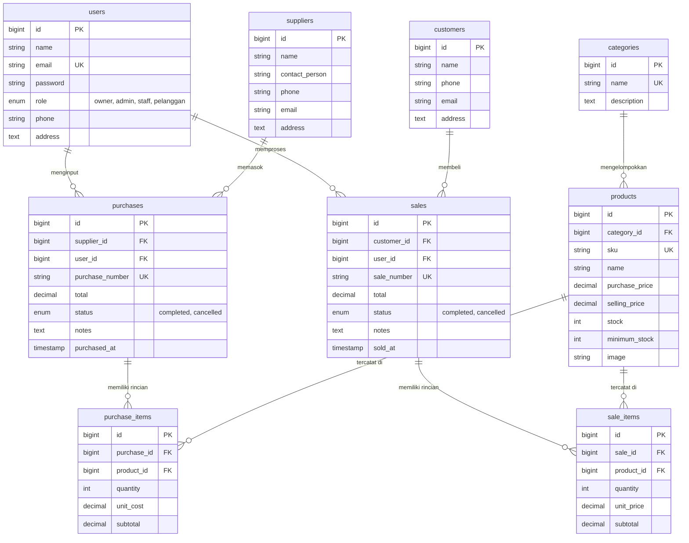

# 📷 CameraStore — Inventory & Sales Management System
### Integrated Laravel Project • Ujian Tengah Semester (UTS) Web Programming 2

Aplikasi bisnis terintegrasi untuk manajemen inventori dan penjualan toko kamera menggunakan **Laravel 10**, **MySQL**, **Eloquent ORM**, autentikasi, otorisasi berbasis role, validasi server-side yang ketat, dan logika bisnis transaksi atomik (`DB::transaction`).

---

## 📑 Daftar Isi
1. [Ringkasan Proyek (Overview)](#1-ringkasan-proyek-overview)
2. [Persyaratan Sistem (Requirements)](#2-persyaratan-sistem-requirements)
3. [Panduan Instalasi & Menjalankan](#3-panduan-instalasi--menjalankan)
4. [Akun Demo & Hak Akses (Role-Based Access)](#4-akun-demo--hak-akses-role-based-access)
5. [Struktur Database & ERD Final](#5-struktur-database--erd-final)
6. [Business Logic & Konsistensi Stok](#6-business-logic--konsistensi-stok)
7. [Fitur Utama Sistem](#7-fitur-utama-sistem)
8. [Pengujian Otomatis (Testing)](#8-pengujian-otomatis-testing)
9. [Batasan Sistem (Known Limitations)](#9-batasan-sistem-known-limitations)

---

## 1. Ringkasan Proyek (Overview)
Sebuah usaha distribusi dan retail kamera mengelola produk kamera (Mirrorless, DSLR, Action Cam, Lensa, Aksesoris), distributor resmi, pembelian stok masuk (*Stock In*), dan penjualan (*Stock Out* / Pesanan Pelanggan). 

Sistem ini memecahkan masalah:
- **Konsistensi Stok**: Stok berubah otomatis saat pembelian atau penjualan berhasil.
- **Pencegahan Overselling**: Penjualan otomatis ditolak jika stok barang tidak mencukupi, tanpa ada data transaksi setengah tersimpan.
- **Pemisahan Hak Akses Ketat**:
  - **Owner**: Memiliki kontrol penuh atas seluruh sistem (CRUD Kategori, Produk, Supplier, User/Pengguna, membatalkan transaksi, laporan dan ringkasan).
  - **Admin & Staff**: Memiliki izin setara untuk operasional harian. **Tidak dapat** menambah/mengedit/menghapus produk atau supplier. **Hanya dapat** menambah stok masuk (*Stock In / Purchases*) dan memproses penjualan (*Sales*).
  - **Pelanggan**: Dapat melihat katalog kamera online, melihat ketersediaan stok, memesan unit kamera, dan melihat faktur/riwayat pesanan.

---

## 2. Persyaratan Sistem (Requirements)
- **PHP**: `^8.1` atau `^8.2` (dengan ekstensi: `pdo_mysql`, `mbstring`, `openssl`, `bcmath`)
- **Composer**: `^2.0`
- **Database**: MySQL `^8.0` atau MariaDB (misal via XAMPP)
- **Web Browser**: Chrome, Firefox, Edge, Safari modern

---

## 3. Panduan Instalasi & Menjalankan

### Langkah 1: Clone / Siapkan Proyek
```bash
cd "c:\Users\USER\Downloads\project inventori sales_uts"
```

### Langkah 2: Install Dependensi PHP
```bash
composer install
```

### Langkah 3: Konfigurasi Environment (`.env`)
Salin file template `.env.example` (jika belum ada file `.env`):
```bash
cp .env.example .env
php artisan key:generate
```
Sesuaikan konfigurasi database pada `.env`:
```env
DB_CONNECTION=mysql
DB_HOST=127.0.0.1
DB_PORT=3306
DB_DATABASE=inventory_sales
DB_USERNAME=root
DB_PASSWORD=
```

### Langkah 4: Migrasi & Database Seeding
Jalankan migrasi seluruh tabel sekaligus pengisian data demo realistis:
```bash
php artisan migrate:fresh --seed
```

### Langkah 5: Jalankan Server Lokal
```bash
php artisan serve
```
Akses aplikasi melalui browser: **`http://127.0.0.1:8000`**

---

## 4. Akun Demo & Hak Akses (Role-Based Access)

Semua akun demo menggunakan password default: **`password`**

| Role | Email Login | Password | Hak Akses & Kemampuan |
|---|---|---|---|
| **Owner** | `owner@camera.com` | `password` | **Bisa Semua**: CRUD Produk, CRUD Supplier, CRUD Kategori, CRUD Pengguna, Batalkan Transaksi, Dashboard lengkap |
| **Admin** | `admin@camera.com` | `password` | Operasional: Lihat Produk & Supplier, **Input Stock In (Pembelian)**, **Input Penjualan**, Kelola Pelanggan (*Tidak bisa tambah/edit produk & supplier*) |
| **Staff** | `staff@camera.com` | `password` | Setara Admin: **Input Stock In (Pembelian)**, **Input Penjualan**, Lihat Produk & Supplier (*Tidak bisa tambah/edit produk & supplier*) |
| **Pelanggan** | `pelanggan@camera.com` | `password` | Toko Online: Jelajahi katalog kamera, pesan kamera online, unduh/cetak faktur belanja, lacak pesanan |

> **Penting**: Otorisasi dilindungi secara **server-side** menggunakan middleware `owner` dan `internal` serta pengecekan di controller, bukan sekadar menyembunyikan tombol pada Blade UI.

---

## 5. Struktur Database & ERD Final



---

## 6. Business Logic & Konsistensi Stok

### A. Alur Stock In (Pembelian)
1. Staff / Admin / Owner memilih supplier dan menambahkan produk serta kuantitas.
2. Validasi memastikan kuantitas > 0 dan unit cost >= 0.
3. Transaksi dieksekusi dalam **`DB::transaction()`**:
   - Header `purchases` dibuat dengan nomor transaksi unik (`PUR-YYYYMMDD-0001`).
   - Setiap item disimpan ke tabel `purchase_items`.
   - Stok fisik produk bertambah (`$product->increment('stock', $qty)`).
   - Total nominal dihitung di server.

### B. Alur Stock Out (Penjualan / Pemesanan Pelanggan)
1. Pembeli atau petugas memilih produk dan kuantitas.
2. Sistem mengunci baris produk (`Product::lockForUpdate()`) untuk mencegah *race condition / overselling*.
3. Sistem memeriksa ketersediaan stok:
   ```php
   if ($qty < 1 || $product->stock < $qty) {
       throw ValidationException::withMessages([
           'items' => "Stok produk '{$product->name}' tidak mencukupi!",
       ]);
   }
   ```
4. Harga produk diambil dari database (`$product->selling_price`), bukan dari input browser.
5. Stok produk dikurangi (`$product->decrement('stock', $qty)`).
6. Jika terjadi kesalahan pada salah satu item, **seluruh transaksi di-rollback secara atomik**.

### C. Pembatalan Transaksi (Cancellation Rules)
- Hanya akun bertipe **Owner** yang memiliki wewenang membatalkan transaksi.
- Pembatalan transaksi penjualan akan mengembalikan stok (increment).
- Pembatalan transaksi pembelian akan mengurangi kembali stok yang pernah masuk (decrement).

---

## 7. Fitur Utama Sistem

- 📊 **Dashboard Interaktif**: Statistik total produk, total pelanggan, penjualan hari ini, penjualan bulanan, daftar peringatan produk dengan stok di bawah minimum, dan riwayat transaksi terkini.
- 📦 **Master Produk Kamera**: Dilengkapi SKU unik, kategori, harga beli, harga jual, badge peringatan stok menipis, dan riwayat pergerakan barang.
- 🚚 **Pemasok (Suppliers)**: Pendataan distributor resmi dan kontak PIC.
- 👥 **Pelanggan (Customers)**: Manajemen data pembeli, studio foto, dan rekam jejak pembelian.
- 🛒 **Katalog Toko Online & Pemesanan Mandiri**: Pelanggan dapat melihat katalog kamera, memilih unit, mengisi alamat, dan langsung memesan secara online.
- 🧾 **Faktur & Invoice**: Dilengkapi fitur cetak (*print-ready*) faktur penjualan dan pembelian.
- 🔍 **Pencarian, Filter, & Pagination**: Filter berdasarkan rentang tanggal, status transaksi, pencarian nama/SKU, dan pagination responsif.

---

## 8. Pengujian Otomatis (Testing)

Aplikasi dilengkapi dengan automated test suite (Unit & Feature Testing):

```bash
php artisan test
```

### Hasil Pengujian (12 Tests Passed, 26 Assertions):
- `✓ guest cannot access dashboard` — Tamu tidak dapat membuka dashboard tanpa login
- `✓ login with invalid credentials is rejected` — Password salah ditolak
- `✓ owner can create product` — Owner berhasil menambah produk
- `✓ staff and admin cannot create product` — Staff & Admin ditolak (403) saat mencoba menambah produk
- `✓ duplicate sku is rejected` — Validasi SKU unik di server
- `✓ purchase stock in increments product stock` — Pembelian berhasil menambah stok
- `✓ sale decrements product stock` — Penjualan berhasil mengurangi stok
- `✓ insufficient stock rejects sale` — Penjualan melebihi stok ditolak dan stok tidak berubah
- `✓ customer can place online order` — Pelanggan berhasil memesan kamera dan stok terpotong otomatis
- `✓ owner can cancel sale and restore stock` — Pembatalan oleh Owner memulihkan stok barang secara akurat

---

## 9. Batasan Sistem (Known Limitations)
- Transaksi pembayaran saat ini menggunakan mekanisme simulasi (*Cash on Delivery* / Transfer Manual), belum terintegrasi dengan Payment Gateway pihak ketiga (Midtrans/Xendit).
- Aplikasi dirancang untuk single warehouse (satu gudang terpusat).
# inventory-sales-jual-kamera

